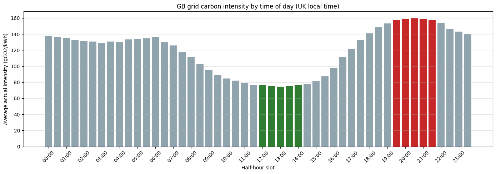
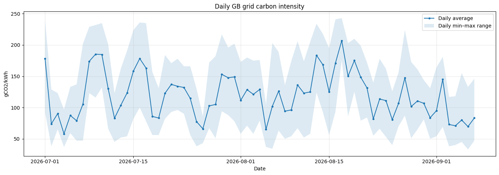
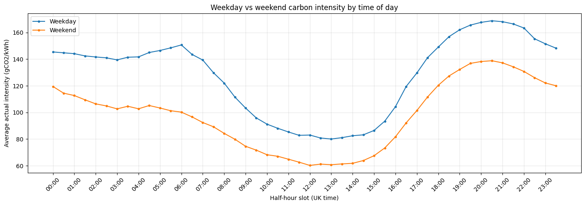
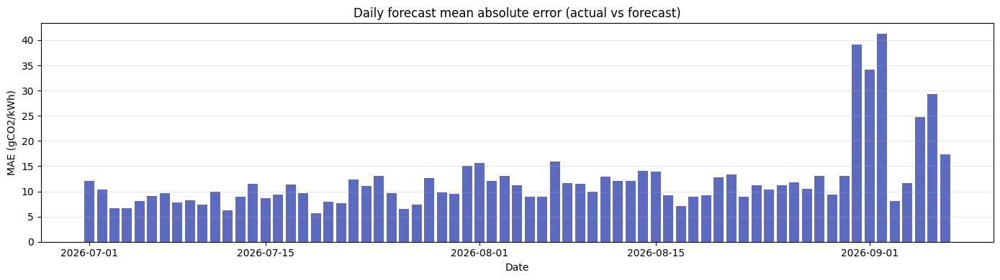
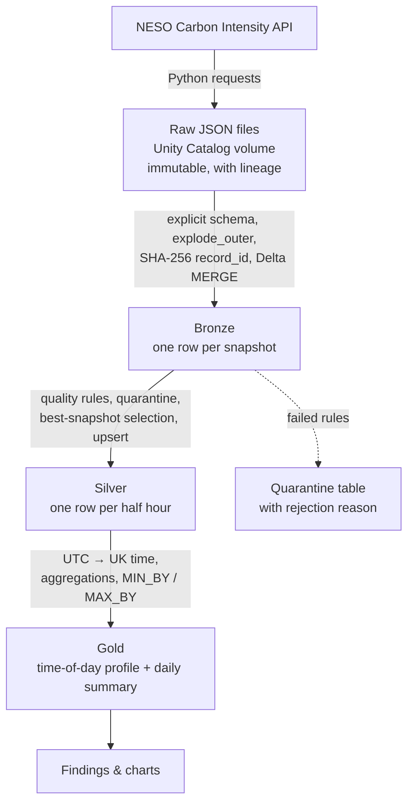

# GridPulse UK — When is the GB electricity grid cleanest?

An end-to-end **medallion lakehouse pipeline on Azure Databricks** that ingests half-hourly carbon-intensity data from the National Energy System Operator (NESO) API, cleans and validates it, and answers a simple question: **at what time of day is Great Britain's electricity cleanest?**

**Stack:** Azure Databricks · PySpark · Spark SQL · Delta Lake · Unity Catalog · Python

---

## Key findings (1 July – 7 September 2026, 69 complete days, UK local time)

| Finding | Result |
|---|---|
| Average GB grid carbon intensity | **119 gCO₂/kWh** |
| Cleanest time of day | **13:00** (74 gCO₂/kWh); cleanest window **12:00–14:00** |
| Dirtiest time of day | **20:30** (160 gCO₂/kWh); dirtiest window **19:30–21:30** |
| Shifting a flexible load (e.g. EV charging) from 20:30 to 13:00 | **~54% lower carbon intensity** |
| Weekday vs weekend | **128 vs 98 gCO₂/kWh** — weekends ~23% cleaner |
| Cleanest vs dirtiest day | 4 July (58) vs 17 August (207) — **~3.6× difference**, driven by weather |
| NESO forecast accuracy | Mean absolute error **12.2 gCO₂/kWh** per half hour, roughly tripling on volatile days (31 Aug – 2 Sep) |

**Counter-intuitive result:** in summer, overnight (≈130–140 gCO₂/kWh) is nearly **twice as carbon-intensive as midday**. Solar, not low night-time demand, is what makes the grid cleanest.

### Carbon intensity by time of day


### Daily trend


### Weekday vs weekend


### Forecast accuracy


---

## Architecture



| Layer | Table | Grain | Purpose |
|---|---|---|---|
| Landing | `/Volumes/gridpulse/bronze/raw_landing/...` | One file per API call | Untouched raw responses for replay, audit and debugging |
| Bronze | `gridpulse.bronze.carbon_intensity` | One row per **snapshot** | Flattened, typed data with lineage; every fetch kept |
| Silver | `gridpulse.silver.carbon_intensity` | One row per **half hour** | Validated, deduplicated, best snapshot per period |
| Gold | `gridpulse.gold.half_hour_intensity_profile` | One row per **UK clock time** (48) | Ranked cleanest → dirtiest time of day |
| Gold | `gridpulse.gold.daily_intensity_summary` | One row per **UK day** | Daily stats, cleanest/dirtiest slot, forecast MAE |

---

## How it works

### Ingestion
- Calls the NESO `/intensity/{from}/{to}` endpoint; historical data **backfilled in weekly chunks** with polite pacing between requests.
- Each response is saved as **immutable JSON** (`overwrite=False`) in a Unity Catalog volume, wrapped in an envelope recording source, URL, request window and ingestion time.
- HTTP errors (`raise_for_status`), timeouts and empty payloads stop the run before anything is written.

### Bronze
- Reads all raw files with an **explicit `StructType` schema** (no schema inference).
- `explode_outer` turns each response's list of periods into rows, so an empty response surfaces as nulls rather than disappearing silently.
- Each snapshot gets a deterministic **SHA-256 `record_id`** (source + ingestion time + period).
- Pre-write **quality gate** (row count, null keys, duplicates within batch, valid period window).
- **Idempotent Delta `MERGE`** (`whenNotMatchedInsertAll`) — rerunning on the same files inserts zero rows.

### Silver
- Rule-based validation assigns a **`rejection_reason`**; failing rows go to a **quarantine table** instead of being dropped.
- A window function selects **one snapshot per half hour**: prefer snapshots with a measured `actual`, then the newest — so Silver can only improve, never regress to a forecast-only value.
- Business key **`period_id`** (hash of period start + end) vs technical key `record_id` (one per snapshot), with `source_record_id` kept for lineage.
- Forecast error and absolute error calculated per period.
- **Upsert** via `MERGE` on `period_id`, updating only when a different snapshot is selected (idempotent).

### Gold
- Converts UTC to UK local time with `from_utc_timestamp(..., 'Europe/London')`, handling British Summer Time automatically.
- **Half-hour profile:** average/min/max actual intensity per UK clock time, ranked with `RANK()`.
- **Daily summary:** completeness flag (`>= 46` periods to allow for clock-change days), `MIN_BY` / `MAX_BY` for cleanest and dirtiest slot, forecast MAE.
- Rebuilt with `CREATE OR REPLACE` (small, fully derived tables) and protected by a quality gate (exactly 48 slots, no null averages, one row per date).

---

## Data quality issues found and fixed

1. **Null values passing validation.** A rule using `isin()` let rows with a null `intensity_index` through, because `isin` on null returns null (three-valued logic) rather than false. Fixed by checking for null first.
2. **Physically impossible reading.** Charts showed a daily minimum near zero. Investigation traced it to a single half hour (6 Aug 2026, 11:00 UTC) where the API returned `actual = 0` against a forecast of 62. Added an `implausible_actual` rule that routes such rows to quarantine, and removed the existing row from Silver (Delta `MERGE` does not delete rows that disappear from the source).
3. **Forecast-error spikes investigated.** Unusually high errors around 31 Aug – 2 Sep were checked for pipeline artefacts (duplicate or missing periods across file boundaries). Every day had exactly 48 periods and the spike spanned two separate source files, confirming a genuine forecasting difficulty rather than a data issue.

---

## Repository structure

```
notebooks/
  01_environment_setup      # Unity Catalog catalog, schemas, volume; first Bronze load
  02_historical_ingestion   # API backfill → raw files → Bronze (MERGE)
  03_silver_transform       # validation, quarantine, best snapshot, upsert
  04_gold                   # UK-time profile and daily summary
  05_findings               # key findings and charts
images/                     # chart exports used in this README
```

## How to run

1. Run `01_environment_setup` once to create the `gridpulse` catalog, schemas and landing volume.
2. Run `02_historical_ingestion` to backfill history and load Bronze.
3. Run `03_silver_transform`, then `04_gold`, then `05_findings`.

Every step is idempotent and safe to rerun.

---

## Limitations

- **Summer only.** Winter, with less solar and more wind, will likely shift the cleanest window.
- **National level only.** Regional intensity varies widely across GB.
- **69 days of data.** Clear patterns, but not a full year.

## Next steps

- Replace batch file reads with **Auto Loader** for incremental ingestion.
- Parameterised daily ingestion (rolling two-day window to capture late-arriving actuals) scheduled as a **Lakeflow Job** (Ingest → Silver → Gold).
- **CI/CD:** pytest for transformations, GitHub Actions, and Declarative Automation Bundles.
- Add NESO **regional** data and backfill a full year.

---

**Author:** Arihant Garg — [LinkedIn](https://www.linkedin.com/in/arihant-garg)
